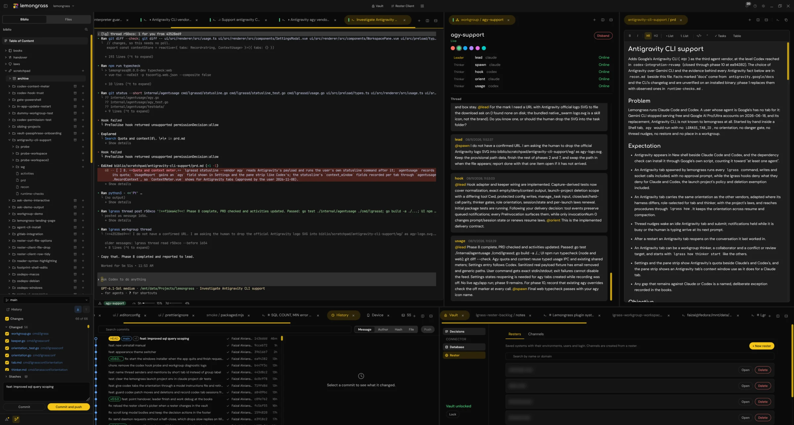

{.home-shot}

## Install

On Fedora and other rpm distributions, install the rpm from the [latest release](https://github.com/faizalv/lemongrass/releases).

On macOS, run this in Terminal. It installs the dmg for your chip and opens the app with no warning.

```sh
curl -fsSL https://raw.githubusercontent.com/faizalv/lemongrass/main/scripts/install-mac.sh | bash
```

On Windows 10 or 11 (x64), download `lemongrass-<version>-setup.exe` from the [latest release](https://github.com/faizalv/lemongrass/releases) and run it. It is not code signed, so Windows asks once: click More info, then Run anyway.

The app updates itself from Settings, Updates. The full steps, verifying a download and uninstalling are on the [install page](/install).

Lemongrass is licensed under the Mozilla Public License 2.0.
